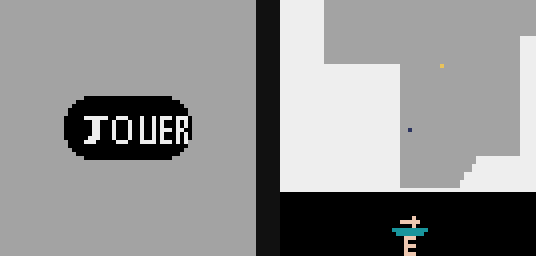

# Valopyx

Mini-jeu de tir tactique en pixel art, inspiré de Valorant, écrit en Python avec [Pyxel](https://github.com/kitao/pyxel).

> **Projet de lycée (2024)**, réalisé avant que j'apprenne la programmation orientée objet. Je le garde tel quel pour montrer d'où je pars.



## Le jeu

Tu joues un attaquant, et il y a deux façons de gagner :

- **éliminer les 5 ennemis** (pixels roses) placés au hasard sur la carte ;
- **faire exploser le spike** (pixel jaune) : ramasse-le, plante-le sur un des deux sites, puis tiens 20 secondes sans qu'un ennemi vienne le désamorcer.

Les ennemis ne bougent pas d'eux-mêmes. Quand tu t'approches d'un site (A ou B), ceux qui n'y sont pas assignés font une **rotation** : ils rejoignent le site par le chemin le plus court.

## Commandes

| Touche | Action |
|---|---|
| Z Q S D | se déplacer |
| E | dash (avec temps de recharge) |
| Clic gauche | tirer vers la souris |
| G | ramasser le spike |
| R | planter le spike sur un site |
| Espace | rejouer après une victoire ou une défaite |

## Sous le capot

- **Pathfinding A\*** avec une file de priorité, pour les rotations des ennemis et pour envoyer un ennemi désamorcer le spike. La grille est construite à partir de l'image de la carte (`fond2.png`).
- **Ligne de vue** : un ennemi n'est visible et ne tire que si aucun mur ne le sépare du joueur.
- **Caméra** qui suit le joueur sur une carte plus grande que l'écran de 64 × 64 pixels.

## Lancer le jeu

Prérequis : Python 3.10 ou plus récent.

```bash
git clone https://github.com/Benjamingllm/Valopyx.git
cd Valopyx
pip install -r requirements.txt
cd Jeu
python projet_eleve.py
```

Le jeu se lance depuis le dossier `Jeu`, où il charge `projet_eleve.pyxres` et `fond2.png`. Testé avec Pyxel 3.

## Si je le refaisais aujourd'hui

- Des classes `Player`, `Enemy` et `Spike` à la place des variables globales.
- Une seule fonction de ligne de vue au lieu de quatre (`check_right`, `check_left`, `check_up`, `check_down`).
- La logique du jeu séparée de l'affichage.
